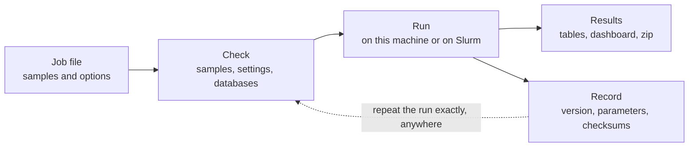

# gnoto

**Reproducible microbiome analysis on your own hardware.**

gnoto turns 16S amplicon and shotgun metagenomic reads into composition tables, diversity
measures and a dashboard anyone can open. It also records exactly how each result was made,
so the same run can be repeated next month or in five years, on your cluster or someone
else's, and give the same answer.

It packages three widely used pipelines, nf-core/ampliseq, nf-core/taxprofiler and a
bioBakery workflow, as one tool that installs by unpacking a folder. It runs on a single Linux
workstation or a Slurm cluster, and needs nothing installed beyond Apptainer.

The name, said *NO-toe*, comes from *gnotobiotic*: an organism in which everything living in
or on it is known. A gnoto run is the same. Every input is identified.

> **Status:** gnoto is in active development at the Alkek Center for Metagenomics and
> Microbiome Research (CMMR) at Baylor College of Medicine, and hasn't had its first release
> yet. All three pipelines already run end to end on CMMR's cluster. See
> [Project status](#project-status).

## The problem

Microbiome results are hard to reproduce, even for the lab that produced them. The same
pipeline can quietly give a different answer when:

- a tool's container tag starts pointing at a newer build
- a reference database is updated in place, or its download link changes
- the pipeline pulls configuration from the internet as it runs
- a cluster setting, such as how many CPUs a task gets, changes a result
- nobody wrote down which version ran, with which parameters, on which files

Then there's the work around the analysis: installing Nextflow, Java and a container cache
for each pipeline, downloading and checking hundreds of gigabytes of reference databases, and
handing collaborators a folder of files they don't know how to read.

gnoto takes care of all of that, so the analysis is the only thing left to think about.

## What gnoto does

### Every run can be repeated exactly

Each job names a version of gnoto, and that version pins everything else: the pipeline code,
Nextflow, every tool's container image by its digest, and every reference database by its
checksum. Nothing is looked up by a name that can change underneath you.

When a run finishes, it leaves a small **record** beside its results: the version, every
parameter, and a checksum of every input file and every core output table. Give that record
back to gnoto with the reads, and it runs the job again exactly, at your site or another one.
Input files are matched by their contents, so they can have been renamed or moved since.

At the end of a re-run, gnoto compares its tables with the original's and tells you how they
compare:

| What's compared | What gnoto checks |
| --- | --- |
| Ingredients: code, tools, databases and inputs | That they're identical, before the run starts |
| Core tables, on the same hardware | That they're identical, byte for byte |
| Core tables, on other hardware | How close they are, reporting the largest difference |

One rule holds this together: **your site's settings say where a job runs and where its
results go, never what the results are.** How many CPUs a task may use, which partition it
runs on and where the results are delivered can all change without changing a single number.

### It checks itself against known answers

`gnoto selftest` runs each pipeline on public mock communities, samples whose makeup is known,
and compares the results with reference tables that ship with each release. You know your
install gets the same answers ours does before you run your own samples.

### It works things out from the data

You don't have to tell gnoto which 16S region you sequenced, which primers you used, or which
sequencing platform made the reads. It measures them from the reads themselves, and records
what it found so a re-run doesn't have to guess again. It fetches the reference databases a
job needs and checks every download against a known checksum before using it.

### Results people can read

Every run comes with its own dashboard: an overview with composition and diversity charts, a
plain-language account of the methods, and an index of every file with a note on what it
holds. While a job runs, the same page shows its progress. The pages need no internet
connection to view, and the whole run, reads, tables, reports and pages, can be delivered as
a single zip. Tables are plain tab-separated text, and 16S feature tables come in BIOM format
too.

### Easy to install, safe to upgrade

Installing is unpacking a folder, with no root access, compilers or conda environments.
Every tool gnoto needs comes in pinned container images.

Each version of gnoto lives in its own read-only copy, so an upgrade never touches a job
that's already running, and going back to an earlier version is one command. A job can also
name its version, as `ampliseq@1.2.0`, and it will mean the same thing for good.

### Made for shared clusters

One install serves a whole group. Jobs run as the person who submits them, so accounting and
file ownership follow that person, and anyone in the group can see what's running or stop a
job. A failed run resumes where it stopped, reusing every step that finished. gnoto checks
the compute nodes too, and keeps its jobs off any node that can't run them, such as one
missing a shared filesystem. Results can be removed when they're no longer needed, and each
run's record is kept afterward, so the run can still be repeated.

### Optional: run it as a service

For sequencing cores, gnoto can take requests from a Wrike form, report each job's progress
back there, publish dashboards to the web through Amazon S3, deliver data through Globus,
and expire results on a schedule. Each piece is optional, and gnoto works fully without any
of them. *These integrations are being built now.*

## The pipelines

| Pipeline | For | What it runs |
| --- | --- | --- |
| `ampliseq` | 16S rRNA amplicons, from Illumina (paired or single-end) or Oxford Nanopore | [nf-core/ampliseq](https://nf-co.re/ampliseq): DADA2 sequence variants, SILVA taxonomy, phylogenetic placement, and optional PICRUSt2 functional prediction |
| `taxprofiler` | Shotgun metagenomes, from Illumina, Oxford Nanopore or PacBio | [nf-core/taxprofiler](https://nf-co.re/taxprofiler): host read removal, Kraken2 and Bracken, MetaPhlAn and mOTUs profiles, and Nonpareil coverage estimates, followed by HUMAnN functional profiles |
| `biobakery` | Shotgun metagenomes, from Illumina | The [bioBakery](https://github.com/biobakery) tools: host read removal, KneadData, MetaPhlAn taxonomy and HUMAnN function, plus mOTUs, Nonpareil, Marker-MAGu for phages, and optional EsViritu for viruses |

The shotgun pipelines remove human, mouse or PhiX reads, as each job chooses. gnoto sets
sensible defaults, and any option the upstream pipeline accepts can be added to a job.

## How it works

A job is a short text file: a title, a samplesheet listing the FASTQ files, and any options.
gnoto checks it, fetches anything missing, and runs it, on the machine you're on or through
Slurm.

```bash
gnoto start ampliseq --title="Gut pilot" --samplesheet=samples.tsv
gnoto status
```

`gnoto start` writes the job file and runs it in one step, and `gnoto new` writes one for you
to edit first. Each run produces its results, its dashboard and its record:



To repeat a run, point gnoto at its record and wherever the reads are now:

```bash
gnoto run --inputs=/path/to/reads record.yaml
```

To run the same analysis on new samples, copy the job file and change its samplesheet.

## Requirements

- Linux on x86-64
- [Apptainer](https://apptainer.org), installed by your administrators or by you without root
- Network access from wherever jobs run, to fetch pipelines, tool images and databases
- Room for reference databases: hundreds of gigabytes for the shotgun pipelines, far less
  for 16S
- Optionally, a Slurm cluster. Without one, jobs run on the machine gnoto is started on.

Slurm and Apptainer are supported first. Support for other schedulers and container engines
is planned.

## Getting started

gnoto installs into one folder and needs no configuration to start. Until the first release,
install it from a clone:

```bash
git clone https://github.com/cmmr/gnoto.git
gnoto/gnoto lint
```

Once releases begin, download and unpack one instead:

```bash
curl -fsSL https://github.com/cmmr/gnoto/releases/latest/download/gnoto.tar.gz | tar -xz
gnoto/gnoto lint
```

The first command pulls gnoto's image and checks the install. If Apptainer isn't on your
`PATH`, `gnoto init --apptainer=/path/to/apptainer` tells gnoto where it is. On a Slurm
cluster, turn Slurm on, and gnoto suggests its settings from what the cluster reports:

```bash
gnoto/gnoto config slurm --on
```

From the first release, `gnoto selftest` then confirms your install gets the expected answers
on public mock communities.

Full documentation, covering configuration, job options, sharing an install between users
and the integrations, will be on gnoto's documentation site at `cmmr.github.io/gnoto`. Until
then, [docs/design.md](docs/design.md) describes everything in depth.

## Project status

- **Working now,** on CMMR's Slurm cluster: all three pipelines, with every tool image and
  database pinned; repeating a job from its record; upgrading to a new version; and resuming
  a failed run.
- **Built, finishing testing:** comparing a re-run's tables with the original's, and
  `gnoto selftest`, whose reference tables arrive with the first release.
- **Next:** the Wrike, S3, Globus and scheduled-expiry integrations, then the first release,
  with downloadable releases and the documentation site.

## Built on

gnoto supplies the packaging and the guarantees. The science comes from the projects it runs,
so please cite them in published work: [Nextflow](https://www.nextflow.io),
[nf-core/ampliseq](https://nf-co.re/ampliseq), [nf-core/taxprofiler](https://nf-co.re/taxprofiler),
DADA2, SILVA, EPA-NG, PICRUSt2, Kraken2, Bracken, MetaPhlAn, HUMAnN, KneadData, mOTUs,
Nonpareil, Marker-MAGu, EsViritu and [rbiom](https://github.com/cmmr/rbiom).

## License

[MIT](LICENSE). Copyright 2026 the Alkek Center for Metagenomics and Microbiome Research.
