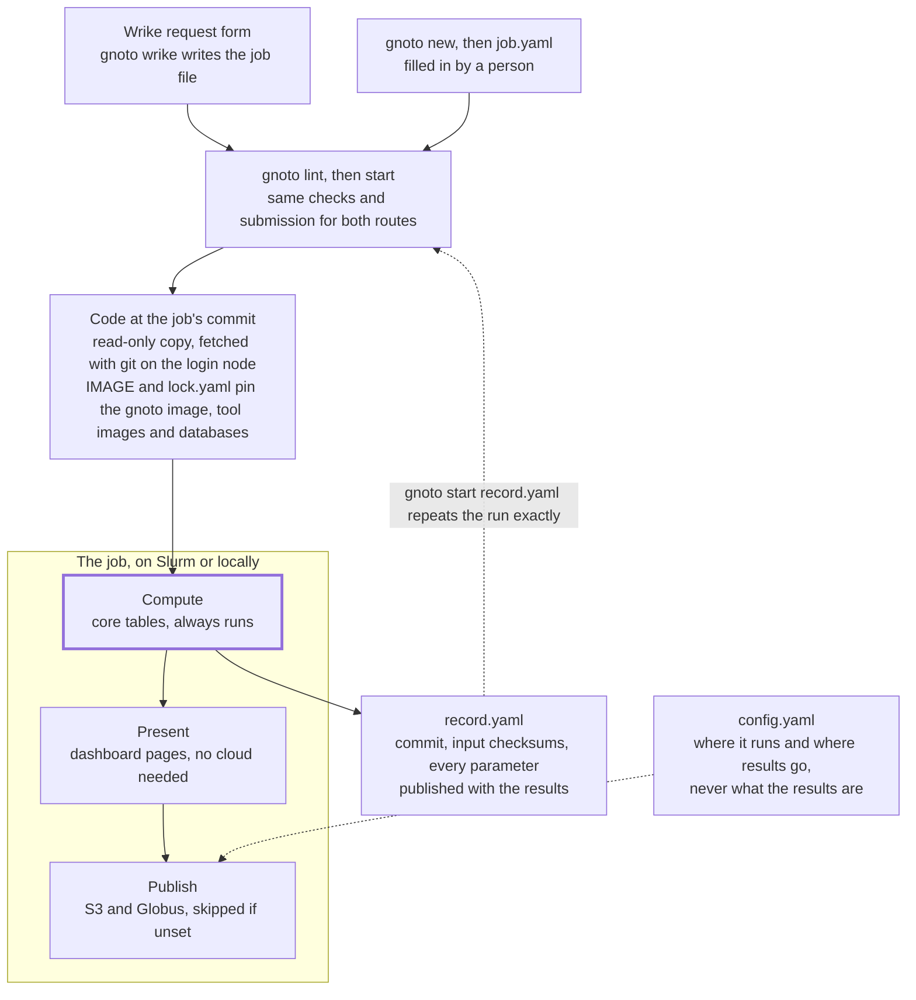
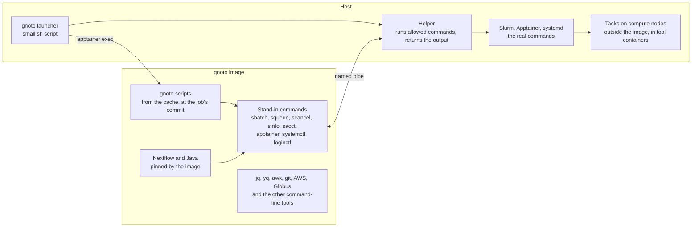

# gnoto design

Status on 2026-11-06: the design is agreed. Phase 1, the image and the helper, is built and
tested in a local Slurm test bed and on CMMR's cluster, and phase 2, the restructure, in the
test bed. This file describes the target. [migration.md](migration.md) says how to get there
from the old repo, and [decisions.md](decisions.md) records why things are the
way they are.

## Summary

gnoto is one installable tool in which a job is a file, and every job runs from a
read-only copy of the exact commit it names. Users install only Apptainer. Wrike,
AWS, Globus and systemd are optional parts around that core.

One rule decides most questions below: **site config says where a job runs and
where its results go, never what the results are.**

- **Install:** download a release tarball and extract it. With Apptainer on `PATH`, gnoto
  runs as it is. Otherwise `gnoto init --apptainer=<path>` says where it is.
  `gnoto config <section>` adds a section of settings when a site wants one.
- **Interface:** one `gnoto` command with `init`, `config`, `lint`, `status`, `new`,
  `start`, `wrike`, `publish`, `cancel`, `extend`, `remove`, `prune`, `upgrade` and
  `selftest`.
- **Jobs:** `new` writes a skeleton, `lint` checks it, and `start` turns it into a
  record that can re-run the job.
- **Versions:** `ampliseq` uses the current release, and `ampliseq@1.2.0` that
  release. Every job runs from a read-only copy of its commit.
- **Tools:** a pinned `gnoto` image holds every tool except Slurm, Apptainer and
  systemd, which a small helper runs on the host.

Nothing is in production, so there's no compatibility or cutover work. The one piece
of Wrike configuration `config` can't automate is the request form: it prints a
checklist for it, then checks the result. The other steps done by hand are listed
under "Configuring integrations".

## Architecture

Code, state and settings are kept apart. Code is read-only at a commit, state
lives under `core.data_dir`, and settings live in `config.yaml`.



Both routes end in the same job file and the same submission. Compute is
highlighted because it's the only stage that makes results. The dashed line shows
that settings reach Publish but not Compute. Settings also choose the scheduler,
but not what the job calculates. `slurm.max_cpus` and `core.nextflow_config` are the
settings to watch, as covered under "What same output means" and "Configuration".

**The job's three stages:**

- **Compute:** composition tables and the feature table. These are results, so
  they always run.
- **Present:** the dashboard pages, written into `results/`. These need no cloud
  account.
- **Publish:** S3 and Globus. These are skipped when unset. The deliverables zip holds
  everything: the reads, as zero or more sets of raw, decontaminated and cleaned FASTQs,
  and the results, the dashboard's HTML files included. It's kept in exactly one place:
  Globus if it's set, otherwise S3, otherwise the run directory. S3 also serves the
  dashboard pages and pruned results as a browsable site.

**Repository layout:**

```text
gnoto                 launcher: a small sh script
IMAGE                 the gnoto image's address, by digest
CHANGELOG.md          release notes, shown by gnoto upgrade
host/                 host helper, the stand-in, and allowed/, the host commands per backend
lib/                  entry point in the image, settings loader, gnoto config and config/,
                      which declares each config.yaml section, job runner, run state,
                      parameters, scheduler and container calls, helpers
pipelines/<name>/     definition, options.yaml, lock.yaml, containers.config, stable-files,
                      selftest.yaml, and taxprofiler's database.csv
workflows/, modules/  Nextflow code
conf/                 resource requests, databases.yaml, references.yaml
steps/                compute steps: samplesheets, region detection, tables, reference builds
present/              dashboard templates and rendering
service/wrike/        listener, handlers, API helpers
service/aws/          CloudFormation stacks (IAM user, S3, SQS), Lambda, CloudFront function
service/systemd/      unit templates
service/publish.sh    publish step: S3 upload and the Globus copy
service/expire.sh     daily expiry check, and the teardown remove shares
images/               Nix recipes for the images we build
test/                 helper tests with stub commands, and the Slurm and Apptainer test bed
docs/, mkdocs.yml     the docs site, with docs_hooks.py
.github/workflows/    release and docs CI
README.md             install steps
```

One repo holds everything, so a commit pins everything at once. Pipelines have no
`_01` numbering, because release tags do that job. One tag versions all the
pipelines together, so two versions can hold identical `ampliseq` code. That's
harmless, because `gnoto selftest --dev` shows which pipelines' core tables changed.

## Host and image

Users install only Apptainer. Everything else comes in a pinned `gnoto` image or
is already part of the cluster.

| Where it runs | Tools | Who provides it |
| --- | --- | --- |
| `gnoto` image | Bash 5, coreutils, gawk, sed, grep, find, diff, `ps`, tar, gzip, pigz, lbzip2, zip, unzip, `jq`, `yq` (mikefarah's Go version), `curl`, `openssl`, `flock`, `git`, AWS CLI, `globus-cli`, Java, Nextflow | The image |
| Host | Slurm client, systemd, `sh`, Bash and basic Unix tools | The cluster |
| Host | Apptainer | The cluster, or the user through the [unprivileged install](https://apptainer.org/docs/admin/main/installation.html) |



Only scheduler, container and systemd calls leave the image.

Slurm can't move into the image. Its client has to match the cluster's version,
config and munge socket, so
[binding it into a container](https://support.schedmd.com/show_bug.cgi?id=17024)
needs site-specific paths. A Nix-built image also lacks the system libraries those
host binaries expect.

**How a command runs:**

1. The `gnoto` launcher starts the helper on the host, then runs the real command
   inside the image with `apptainer exec`.
2. Inside the image, the Slurm, Apptainer and systemd commands are stand-ins. Each
   passes its arguments to the helper through a named pipe.
3. The helper runs the real command on the host, from an allowed list only, and
   returns its output and exit code.

**What that covers:**

- **Nextflow:** it runs in the image, and its `sbatch` calls go through the
  stand-in. Slurm then starts each task's `.command.run` on a compute node,
  outside the image, where it uses the host's Apptainer.
- **Step tools (vsearch, gotree, rbiom):** their `apptainer exec` calls also go
  through the helper, so containers never nest.
  [Nesting often works, but only with non-setuid installs](https://apptainer.org/docs/admin/main/user_namespace.html).
- **AWS and Globus:** these need only network and files, so they run in the image.
- **systemd:** the units start the launcher, and `config` reaches `systemctl`
  through the helper.

**Rules that follow:**

- **Same paths inside and outside.** The install directory, `core.data_dir`,
  `core.db_dir`, `globus.dir`, `apptainer.binds` and every FASTQ are bound at their
  host paths, and `lint` checks this.
- **Code stays out of the image.** It's bound in from the version cache, so a
  script change needs no new image.
- **Clean environment.** Jobs enter the image with `--cleanenv`, so host variables
  can't change what they do. Step containers get the same treatment: `lib/containers.sh`
  runs every `apptainer exec` with `--cleanenv --no-home`, sets `LC_ALL=C.UTF-8` and
  `TZ=UTC`, and binds only what the step needs. The helper submits `sbatch` with a fixed
  environment. Nextflow already starts task containers with an empty environment and no
  home directory.
- **Pinned tools.** Each commit's `IMAGE` file names its image, so a re-run gets
  the same awk, `jq` and Nextflow. `IMAGE` is a plain one-line file because the
  `sh` launcher has to read it before it can use `yq`.
- **Bootstrap settings.** Before it can start the image, the launcher also needs
  `core.data_dir`, `core.db_dir`, `apptainer.enabled`, `apptainer.bin_dir`,
  `apptainer.binds`, `slurm.enabled`, `slurm.bin_dir` and `slurm.conf`. It reads just those
  with a small awk that accepts only `key: "value"`, `key: true` and `key: false` lines
  under their section, and `lint` checks with `yq` that both parsers agree. It puts the two
  bin directories first on the `PATH` the helper runs commands with, and sets `SLURM_CONF`,
  so gnoto works from a shell that hasn't loaded a site's Slurm module. Slurm's two count
  only when `slurm.enabled` is `true`. Without `config.yaml`, or for a setting it leaves
  unset, the data directory is `<install>/data` and both commands come from `PATH`. The
  launcher stops if it can't find `apptainer`, or if `apptainer.enabled` is `false`. It pulls the image to a temporary name in `<data_dir>/images/` under a lock, then renames
  it.

Apptainer needs
[unprivileged user namespaces or a setuid install, plus FUSE](https://apptainer.org/docs/admin/main/installation.html).
Tasks already run in Apptainer, so this adds no new requirement.

**Fallback.** If Nextflow misbehaves in the image, gnoto downloads Java and
Nextflow into `core.data_dir`, and the helper runs them on the host. Users still
install nothing beyond Apptainer.

**Other schedulers and runtimes.** gnoto supports Slurm and Apptainer first, and the
README says so. Wider support is planned for later, and each addition should be new code
rather than a rewrite:

- **One place for each.** Scheduler calls (submit, query, cancel, and how a job ended)
  go through `lib/scheduler.sh`. Container calls (exec and pull) go through
  `lib/containers.sh`. Apart from the launcher, the helper and the systemd templates, no
  other script names `sbatch` or `apptainer`.
- **The helper's allowed list is data.** The stand-in names come from one list per
  backend, so supporting `qsub` or `podman` adds entries, not code.
- **Nextflow covers its own part.** Config chooses its executor and container engine, so
  pipeline resource requests stay generic: CPUs, memory and time, with no partition or
  `clusterOptions`.
- **A section picks the backend.** Each backend has a section of its own in `config.yaml`
  for its paths and limits, as `slurm:` and `apptainer:` do now, and its `enabled` says
  whether it's in use. Jobs go to Slurm when `slurm.enabled` is `true`, and run on this
  machine otherwise. `apptainer.enabled` picks the container engine. Two schedulers or two
  engines on at once is an error. `gnoto config <backend>` asks for a backend's settings,
  suggesting what the launcher finds on `PATH`.

Some parts already assume neither: images are OCI, `status` reads state files, and
cancelling uses a cancel file.

## Installing and upgrading

Users install from a release tarball, an asset we build ourselves rather than
GitHub's source archive. An asset can have a fixed name, which gives a permanent
[latest-release URL](https://docs.github.com/en/repositories/releasing-projects-on-github/linking-to-releases).
It can also have a published checksum, because
[source archive bytes can change](https://docs.github.com/en/repositories/working-with-files/using-files/downloading-source-code-archives).

The README's install section:

```bash
curl -fsSL https://github.com/cmmr/gnoto/releases/latest/download/gnoto.tar.gz | tar -xz
gnoto/gnoto lint
```

gnoto needs no configuration to start. With `apptainer` on `PATH`, it keeps its data in
`<install>/data` and runs jobs on the machine it's started on. Without Apptainer it stops and
says to put it on `PATH` or run `gnoto init --apptainer=/path/to/apptainer`. That writes a
`config.yaml` holding only an `apptainer` section that says where it is, runs nothing in the
image, and refuses if there's a `config.yaml` already. A later version can take another
container engine in place of `--apptainer`. `gnoto config` lists the other sections, and
`gnoto config slurm --on`, for one, adds Slurm with what it finds: its commands and
`SLURM_CONF` from the launcher's `PATH`, and its default partition and limits from `sinfo`.

Pinned installs swap `latest/download` for `download/v1.2.0`, with
`gnoto.tar.gz.sha256` beside each asset. On every version tag, a GitHub Actions job
creates a draft release, builds the asset from `git archive` plus a `VERSION` file holding
the tag and commit, uploads it with its checksum, and only then publishes the release.
GitHub's `latest` URL
[skips drafts](https://docs.github.com/en/rest/releases/releases#get-the-latest-release),
so a failed upload never reaches users. The release checks run in CI on `main`, before
anyone tags.

**First run.** The first command pulls the image named in the tarball's `IMAGE`. It
records the tarball's commit, from `VERSION`, as the current release in
`<data_dir>/current`, and fetches that commit into `versions/` with the image's `git`. So it
takes a while. `curl` and `tar` are needed only for the download.

**The install directory's launcher and `config.yaml` are the only files there that gnoto
uses.** Every command runs from
the current release's copy in `versions/`, so the tarball's other files are never run, and
editing them changes nothing. The install directory's launcher is never upgraded. It only
reads its bootstrap settings, finds the current release, and hands over to that release's
own launcher.

**Upgrading.** `gnoto upgrade [version]` fetches the release's tagged commit into
`versions/`, the same way a job fetches its commit. It shows the release notes between the
current release and the new one, from `CHANGELOG.md` in the new release, which say which
pipelines' results changed. After confirmation, it rewrites `<data_dir>/current` to name
the new commit, by writing a temporary file and renaming it. Then it runs `lint`, which
reports units whose templates changed and drift between the Wrike form and the new
`options.yaml`. When run as the units' account on their recorded host, it also restarts
gnoto's systemd units. Otherwise it prints the command for that account to run.

- **Nothing is overwritten,** so a running command or job keeps the code it started with.
- **Going back is a pointer move:** `gnoto upgrade 1.1.0` makes that release current again.
- **Only unpinned names change:** after an upgrade, plain `ampliseq` means the new release
  for jobs created afterward.

## Configuration

Settings and secrets live in `config.yaml` in the install directory, which is gitignored
from the start. It's kept minimal, so opening it shows what's in effect: gnoto runs without
it, with every setting at its default, and it holds only the sections a site has added.
`lib/config/<section>.sh` declares each section: its settings, their types and defaults, the
question `gnoto config` asks for each, and how to find a better suggestion, such as from
`sinfo`. Each version carries its own declarations, so they live under `versions/` like the
rest of the code, and a setting missing from `config.yaml` takes that version's default.
`lint` reports the settings an upgrade added.

`gnoto config` prints each section and what it's for, one per line:

```text
core       Where gnoto keeps its runs, caches and databases, and for how long
apptainer  Where Apptainer is, and the paths containers must see
slurm      Run jobs on a Slurm cluster, rather than on this machine
wrike      Take job requests from a Wrike form, and report each job's progress there
aws        Publish results through S3 and CloudFront, and take Wrike's webhook through SQS
globus     Deliver results through a Globus guest collection
```

`gnoto config <section>` asks for each of the section's settings, suggesting what its
declaration finds, or else the current value. `--on` and `--off` set the section's `enabled`
without asking. When `config.yaml` doesn't have the section yet, either way adds the whole
section, with the answers or with every suggestion, and only that section. Asking turns a
new section on.

Each section but `core` starts with `enabled`, so a section can be set up but not used. A
section is on only when `enabled` is `true`, and code that uses a section checks that first.
`apptainer` is the exception: it's on unless it says `false`, because it's the only container
engine so far, so `gnoto config apptainer --off` refuses. `core` is always on.

On a cluster, `gnoto config slurm --on` and then `gnoto config apptainer` might leave:

```yaml
# This install's settings. gnoto config lists the sections, and adds or changes one.

slurm:
  enabled: true
  bin_dir: "/opt/slurm/current/bin"
  conf: ""
  partition: "main"
  account: ""
  max_cpus: 32
  max_memory: "900.GB"
  max_time: "168.h"
  job_time: ""

apptainer:
  enabled: true
  bin_dir: "/opt/apptainer/bin"
  binds: "/data"
```

Strings are double-quoted, and `enabled` is `true` or `false`, so the launcher's awk can read
its bootstrap settings. An answer replaces the value on its line and keeps the line's comment
in its column, and a key the section lacks goes at its end, so hand edits survive. The image
can't check a host path, so those answers are taken as given.

1. **It's read with `yq`, never sourced.** A stray command can't run on every
   compute node, and the loader decides what gets exported. The launcher's eight
   bootstrap settings are the one exception, as covered under "Host and image". `lint`
   reports a syntax error with its line number. The current release's `lint` also flags
   an unknown key as a likely typo, but no other version does, as covered under
   "Compatibility".
2. **Settings become shell variables inside the code.** `core.data_dir` becomes
   `DATA_DIR`, and every other section's keys take the section as a prefix:
   `slurm.max_cpus` becomes `SLURM_MAX_CPUS`, and `wrike.api_token` becomes
   `WRIKE_API_TOKEN`.
3. **Secrets are never exported.**
   [Apptainer passes host variables into containers by default](https://apptainer.org/docs/user/main/environment_and_metadata.html),
   so an exported AWS key would reach every third-party tool. Small `aws` and
   Wrike wrappers pass secrets to the one call that needs them.
4. **`lint` checks the file's safety.** The mode must be 660, so its group can read
   and write it and nobody else can, and the file must not be tracked by git.
   `generated.yaml` gets the same mode and group. `lint` and the README note that every
   member of that group can use the bot's Wrike token and the AWS keys.
5. **Nothing here can change results.** Image addresses live in the repo at each
   commit, not here. `core.nextflow_config` is the one escape hatch, besides the CPU
   limit covered under "What same output means". The record holds a SHA-256 of its
   contents, and `run_state.json` holds the full text, which can contain site paths. A
   re-run uses its own site's setting and never applies the recorded one. `lint` warns on
   any setting in it that could change results, such as `params`, `container`,
   `process.ext`, `env`, `cpus`, `beforeScript`, `containerOptions` or
   `apptainer.runOptions`. It checks the resolved
   config, so an `includeConfig` can't hide one. `lint` fails if `$NXF_HOME/config`
   exists, because Nextflow loads that file into every run, and gnoto launches Nextflow
   from the run directory so that no stray `nextflow.config` is loaded.

**Machine-written values go in a second file.** `config` writes the site's answers into
`config.yaml`, but Wrike object IDs, custom field and status IDs, `RUN_ID_SALT` and the
outputs of any stack it deploys go to `<data_dir>/generated.yaml`, with the same mode and
group as `config.yaml`, so every group member can read both. A value in `config.yaml` wins.
Losing the salt loses no results, because the output location can still be listed to find
them.

## The command line

The `gnoto` launcher dispatches every command. `new`, `lint job.yaml`, `start` and
`publish` run from the version the job names. Every other command, `status`, `cancel`,
`extend` and `remove` included, runs from the current release, named in
`<data_dir>/current`.

| Command | What it does | Changes anything? |
| --- | --- | --- |
| `gnoto init --apptainer=<path>` | Writes a `config.yaml` holding only `apptainer.bin_dir`, without needing Apptainer on `PATH` or starting the image. Refuses if `config.yaml` exists | Writes one file |
| `gnoto lint` | Checks `config.yaml` and every configured integration | Only temporary test files. As the first command, it also pulls the image and records the current release |
| `gnoto lint [--deep] [--yes] job.yaml` | Checks a job file, its samples and its databases. `--deep` computes every database's full digest. `--yes` accepts a database download | Only if you accept a database download |
| `gnoto config [<section> [--on\|--off]] [--deploy] [--profile <name>] [--move] [--dry-run]` | Lists the sections. Given one, asks for its settings and writes them, adding the section if it's new, or with `--on` or `--off` turns it on or off, adding it with what's found if it's new. An integration's step then does its one-time setup, safe to repeat. `--deploy` builds the AWS pieces as CloudFormation stacks, using the admin `--profile`. `--move` moves the systemd units to this host. `--dry-run` stops after the plan | Yes, after showing the plan |
| `gnoto status [uid]` | Reports integration health, and running and recent jobs. Given a uid, shows that run in detail | No |
| `gnoto new ampliseq[@ref]` | Writes a job skeleton to `ampliseq.yaml` in the current directory, and refuses to overwrite one | Writes one file |
| `gnoto start [--debug] [--dev] job.yaml` | Lints, then submits the job. `--debug` keeps the whole run directory for a while. `--dev` runs a working tree | Yes |
| `gnoto start record.yaml --inputs <dir>` | Re-runs a recorded job exactly | Yes |
| `gnoto wrike [task_id]` | Starts that Wrike task if it's waiting. Without a task ID, runs the reconciliation scan: starts every waiting task in "gnoto Jobs", removes runs whose task is gone, copies Expiration dates and reactivates a suspended webhook | Yes |
| `gnoto publish <uid>` | Runs Present and Publish again for a run whose Compute finished. Safe to repeat | Yes |
| `gnoto cancel <uid>` | Cancels a job | Yes |
| `gnoto extend <uid> <YYYY-MM-DD\|never>` | Keeps a run's results until that date, or for good | Yes |
| `gnoto remove [--yes] <uid>` | Deletes a run's results now and keeps its record. `--yes` skips the prompt, as the listener and the reconciliation scan do | Yes, after confirming |
| `gnoto prune` | Removes cached versions and images that no running or waiting job uses | Yes, after confirming |
| `gnoto upgrade [version]` | Fetches a release into `versions/`, shows its release notes, then makes it current | Yes |
| `gnoto selftest [--dev] [pipeline]` | Runs the fixture jobs from [fixtures.md](fixtures.md) and checks their core tables against the current release's checksums. `--dev` compares a working tree with the last release instead | Only its own runs, and any database fetch you accept |
| `gnoto exec <command>` | For development: runs any command in the image, with the stand-ins on `PATH` | Whatever the command does |

**`lint`.** Each check prints OK, WARN or FAIL, and any FAIL gives a non-zero exit
code. Before `config` has run, `lint` reports what's missing as a WARN that says which
`config` step to run, so a correct `config.yaml` passes its first `lint`. An integration
whose settings are only partly filled in is a FAIL that says what to add.

- **Local:** Apptainer version, the image pull, file modes, and that
  `core.data_dir`, `core.db_dir` and `globus.dir` are writable and visible to
  compute nodes, and that `flock` works on `core.data_dir` from both a login node and a
  compute node. Lustre, for one, needs its `flock` mount option.
- **Scheduler:** `sinfo` responds.
- **Wrike:** the token works, the account's license can create tasks, which
  Collaborator, Contributor and Viewer licenses can't, the request form matches
  `options.yaml`, and the webhook's state.
- **S3:** identity, bucket access under the run prefix, and that `results_base_url`
  serves a test file uploaded there, including a directory page.
- **SQS:** identity, queue access, and how many messages are waiting.
- **Globus:** the URL answers, the client credentials work, and the anonymous read
  permission exists.

**`status`.** A health block comes first, then the jobs. The health block runs no
checks itself: the daily timer runs `lint` and writes the results to a health file in
`<data_dir>/logs/`, beside the heartbeats, and `status` shows that file and its age. So
there's one set of checks, `status` is fast, and every user sees the same answer. For the
jobs, `status` reads state files rather than `squeue --user`, so it lists every user's
jobs and any upcoming expiries.

A job the state files show as running is checked against `squeue`, or `sacct` once it
has left the queue, by its job ID. It shows as "Lost" when Slurm has nothing running for
it, as happens when a job and its followup are killed together. The listener and timers
write a heartbeat file in `<data_dir>/logs/`, so any user's `status` can report them,
although their systemd units belong to one account.

`status <uid>` shows one run in detail: its state and stage, its Slurm job IDs, its run
directory and log paths, the error message, and the last 20 lines of the failing task's
`.command.err`.

```text
Integrations, checked by the daily lint 3 h ago
  slurm     ok    sinfo responding
  wrike     ok    Cluster Bot, webhook Active
  sqs       ok    0 messages waiting
  listener  ok    active for 12 days
  s3        ok
  globus    warn  read permission on /gnoto/ not found

Running
  K3F9A2QX  ampliseq@1.2.0   Running          2h 14m   Running the analysis.

Finished in the last 7 days
  M7QP4T2B  biobakery@1.2.0  Completed        Nov 2    https://...
  R2ZD8H6W  ampliseq@1.1.0   Failed           Oct 30   DADA2 removed every read
```

**`start`.** It lints, creates the run directory, submits the job, prints the uid
and exits. If S3 or Globus is configured, the job publishes to it and `status` shows the
link. Without either, the same dashboard pages and the deliverables zip stay in
`<data_dir>/runs/<uid>/`.

**The head job** is submitted with `--no-requeue`, because by default Slurm restarts a
batch job from the top after a node failure, over a run directory that's already in use.
Its time limit is `slurm.job_time`, which `lint` checks against the partition's MaxTime,
and `--signal=B:TERM@300` gives Nextflow five minutes to cancel its tasks before that
limit. The followup runs whatever happens, and cancels any task the trace still shows as
running.

**Cleanup on success.** The job copies its `job.yaml`, record and final state to
`history/<uid>/`, then deletes the Nextflow work directory and staged inputs. When Globus
or S3 is set, the job checks that the zip arrived, and with S3 the browsable pages too,
then deletes the whole run directory, `results/` included, since the zip holds everything
in it. With Globus alone, the dashboard lives inside the zip, and `status` shows the
Globus link. With neither, `results/` and the zip stay until they expire or `remove`
deletes them.

**Cleanup on failure.** A failed or cancelled run also copies its `job.yaml`, record and
final state to `history/<uid>/`, plus a short error summary that outlasts the logs. It
keeps what's needed to see what went wrong: the job and record files, the run's state,
Nextflow's logs and trace, and every task's `.command.*` files.
Staged inputs and task outputs are deleted at once. The rest goes after
`core.keep_run_days`, 14 by default.

**A failure after Compute keeps the results.** `run_state.json` records each stage as it
finishes. If Present or Publish fails once Compute has finished, the run keeps `results/`,
the zip and the record, as a run with no publishing does, and `status` shows "Publish
failed". `gnoto publish <uid>` submits Present and Publish again as a job, and is safe to
repeat.

**`--debug`.** `gnoto start --debug` keeps the whole run directory for
`core.keep_run_days`, whatever the outcome. The usual cleanup happens after that. The
daily timer does these delayed deletions, so without it nothing is cleared.

**Jobs run as the calling user,** so Slurm accounting and file ownership follow
that person.

**One group owns everything.** The group on `config.yaml`, or on the install directory
before there is one, is gnoto's group. `gnoto init` and `gnoto config` write `config.yaml`
in the user's own group, which suits a single user. To share an install, `chgrp -R` the install directory,
`core.data_dir` and `core.db_dir` to a shared group. gnoto reads the group whenever it sets
permissions: every file and directory it makes is group-readable and group-writable,
and directories get setgid so new files inherit the group. Every gnoto command and job runs under
`umask 002`. Before it exits, each job runs `chmod -R g+rwX` on what it leaves behind,
because a umask can't add permissions to files a tool creates with fixed modes. `lint`
reports any file with another group or without group read and write. The one exception
is the files in `versions/`, which stay read-only, as covered under "Versions and the
code cache". Teardown reports anything it couldn't delete.

**CLI jobs get a Wrike task when Wrike is configured.** `start` creates the task in
"gnoto Jobs" before submitting. Its title comes from the job's `title`, its
description names the caller, and `job.yaml` is attached.

- **Same behavior as a form request:** the uid comes from the task ID, so status
  updates, the results comment, expiry and deleting the task all work the same way.
- **No double submission:** the webhook still fires for the new task, but `start`
  creates it directly in the `Running` status, which
  [task creation accepts](https://developers.wrike.com/reference/postfolderssingletasks.md).
  It's never waiting, so `gnoto wrike` passes it by. If the submission then fails, the
  task moves to `Failed`.
- **Wrike stays optional:** with no `wrike` section the uid is random. If Wrike is
  configured but can't be reached, `start` refuses the job and says why, so every
  job gets its task.

**`wrike`.** This is the form route's way in. A task is waiting when it sits in
"gnoto Jobs" with the status `Submitted`, and has no run directory or history yet. For
each waiting task, `wrike` turns the task's answers into a job file and calls the same
lint and submit code as `start`. A rejection sets the task to `Failed` with the reason in
a comment, which also takes it off the waiting list. Missing databases are fetched
without asking, and the job waits for those fetches to succeed. Given a task ID, it
handles only that task. Without one, it scans the folder. The `mkdir` guard on the run
directory means that two calls racing for one task submit it once.

- **With SQS,** the listener calls `gnoto wrike <task_id>` for each new task, so a
  request starts within seconds. It handles every event in a payload, because Wrike can
  send several at once, and deletes a message from the queue only after handling it.
- **In both modes,** a user timer runs `gnoto wrike` every `wrike.poll_minutes`, which
  is 5 by default, as a reconciliation scan. It starts waiting tasks, runs `remove` for
  runs whose task is gone, copies Expiration dates into `expiry/`, and reactivates the
  webhook if Wrike has suspended it, which `status` reports. Wrike suspends a webhook after
  repeated failed deliveries, and SQS drops messages older than its retention period, so
  SQS mode needs this too. Setting `poll_minutes` to 0 turns the timer off, and then a
  person runs `gnoto wrike` by hand.

**Wrike updates are side effects.** Once a job is submitted, its status changes and
comments are retried with exponential backoff on HTTP 429 and 5xx, as
[Wrike advises](https://developers.wrike.com/docs/errors-api-reference-v4.md). Wrike
allows 400 requests a minute per token. An update that still fails goes to a log that the
daily timer replays. Wrike updates never fail a stage or skip cleanup.

**`cancel`.** Slurm only lets the owner, an admin or an account coordinator cancel a job,
and form jobs run as the service account. So cancelling writes a cancel file in the run
directory, and the job's progress watcher, `present/progress.sh`, which also keeps
`progress.json` current, stops the job when it sees that file. Deleting a Wrike task runs
`remove`, which cancels the same way, so any group member can cancel any job. A job also
checks for a cancel file before it starts work, because a job still waiting in the queue
has no watcher yet.

**Expiry.** Results expire when gnoto's systemd timer is installed, with or without
Wrike. When a run ends, its followup turns `retention` into a removal time and writes it to
`<data_dir>/expiry/<uid>`, in UTC. The time counts from completion, so time spent queued
or running doesn't use up retention, and it's never earlier than completion plus
`core.expiration_notice_days`. Every run that keeps results anywhere, including only in
its run directory, gets a file, failed runs included. With Wrike, the daily check
comments on a task, mentioning its requester, once its removal time is
`expiration_notice_days` away. Without Wrike, `status` lists upcoming expiries.

The daily check acts only on the `expiry/` folder, so its work grows with the runs still
waiting to expire, not with every run ever made. When a removal time passes, it runs the
teardown: it deletes the run's S3 results, Globus archive and local results,
leaves an expired page at the results address naming the run, its dates and its sample
count, and deletes the expiry file.

With Wrike, the task's Expiration date field mirrors the file, and Wrike's date wins:

- **Editing the date in Wrike** sends a `TaskCustomFieldChanged` webhook, and the
  listener rewrites `expiry/<uid>` to match at once. The poll timer's scan makes the same
  update, which covers polling mode and any webhook that didn't arrive.
- **The daily check** copies every date in "gnoto Jobs" into its file before acting. That
  catches changes no webhook reported, such as Wrike's mass edits, which send none.
- **Deleting a task** runs `remove`.

`Unlimited` writes no expiry file. `gnoto extend <uid> <YYYY-MM-DD|never>` writes the file
and, with Wrike, the task's date. `never` makes the run Unlimited by deleting the file, and
a date before the floor is refused. The daily check applies the same floor to dates edited
in Wrike. With no timer installed nothing expires, and `lint` warns about any job whose
`retention` isn't `Unlimited`.

**`remove`.** It runs the same teardown on demand, after a confirmation prompt. If the
job is still running or waiting, `remove` writes the cancel file and a `remove` marker and
returns at once, because deleting the run directory would also delete the cancel file.
The job's followup, which runs as the job's owner, does the teardown once the job has
ended. The record stays in `history/<uid>/`, so the job can be re-run while its inputs
exist. A Wrike task, if there is one, moves to `Expired`.

**Locking.** Every command that acts on one run takes that run's lock: `cancel`,
`extend`, `remove`, `publish`, the expiry check and the job's own cleanup. So an extension
can't land in the middle of a teardown. `prune` takes the cache lock exclusively, and
`start` holds it shared until the run's state names its commit, so `prune` can't delete a
version that a starting job has just resolved. A write that can't get its lock fails, and
never goes ahead unlocked.

## Job files

Three files define a run, and each has one author.

| File | Written by | Holds | Lives in |
| --- | --- | --- | --- |
| `job.yaml` | A person, starting from `new` | Pipeline and version, title, samplesheet, options | Anywhere, with a copy without paths in the run's results |
| `record.yaml` | `start` and the job itself | Commit, input checksums, every resolved parameter | The run's results, published beside them |
| `lock.yaml` | The release process | Upstream commit, tool image digests, database digests | `pipelines/<name>/` in the repo |

**`job.yaml`** keeps gnoto's own settings at the top level, including options that aren't
upstream parameters, such as which reads a taxprofiler job delivers. A section named for
the pipeline holds the parameters passed to it, so `mergepairs_strategy` is
`ampliseq.mergepairs_strategy`. Comments sit on their own lines. `gnoto new ampliseq`
writes:

```yaml
# Check with: gnoto lint <this file>
pipeline: ampliseq@1.2.0

# Names the results
title: ""

# Tab-separated, no header: sample, fastq1, fastq2. Omit fastq2 for single-end.
samplesheet: ""

# 1 Month, 3 Months, 6 Months, 12 Months, 24 Months, Unlimited
retention: "3 Months"

# Passed to nf-core/ampliseq. Leave a value empty for gnoto's default.
# gnoto fetches the reference chosen here and passes it as local files.
# Any other ampliseq parameter can be added here as well.
ampliseq:
  # silva=138.2, greengenes2=2024.09, gtdb=R11-RS232, ...
  dada_ref_taxonomy: ""
  # silva=138, greengenes2=2024.09
  qiime_ref_taxonomy: ""
  # false, true
  picrust: ""
  # merge, concatenate, consensus
  mergepairs_strategy: ""
```

The section's keys and values are the pipeline's own, so the upstream documentation
describes them. A taxprofiler job has a `taxprofiler` section and a biobakery job has
a `biobakery` section, which work the same way.

**How values combine.** `pipeline.sh` sets defaults for the pipeline's parameters and
declares the keys gnoto owns, such as `input`, `outdir` and `metadata`. A job's section
overrides those defaults, and `lint` refuses an owned key. The merged set is what runs,
and it's what `record.yaml` stores in its pipeline section.

`new` always writes a pinned version, even when asked for plain `ampliseq`, so a
later upgrade can't change what an existing job file means.

**`lint job.yaml`** checks that:

- required keys are filled, and every answer uses allowed characters and allowed
  values
- every key in the pipeline's section is a parameter that pipeline accepts at its
  pinned commit, with a value its schema allows. nf-core pipelines are checked against
  their `nextflow_schema.json`, and biobakery against its workflow's params. A key that
  `pipeline.sh` declares as gnoto's own, such as `input`, `outdir` or `metadata`, is
  refused. A key gnoto would measure, such as `primer_fwd`, is allowed, and measuring is
  then skipped, as on a re-run
- a parameter the schema marks as a path uses a `db:` name, so the record holds no site
  paths and the file is checked like any database
- no parameter comes from nf-core's generic or institutional groups, such as
  `custom_config_base` or `config_profile_*`, because those can load config from
  elsewhere at run time and undo the commit's pin. gnoto itself passes `custom_config_base`
  empty, because by default nf-core pipelines load nf-core/configs from its `master` branch
- every reference choice, such as `dada_ref_taxonomy`, has an entry in
  `conf/databases.yaml`. gnoto fetches and checks it like any database, then passes the
  files through the matching `*_ref_tax_custom` parameter, so ampliseq downloads nothing
  itself. ampliseq's own downloads have no checksum check, and some use plain `http://`
- the version resolves and is new enough to run
- the samplesheet parses, and every FASTQ exists, is readable and non-empty, and
  pairs correctly
- in the form route, every FASTQ's real path, after symlinks, sits under one of
  `core.input_roots`. Those jobs run as the service account, so without this a requester
  could publish files they can't read themselves. CLI jobs run as the caller and need no
  such limit, and `lint` fails if Wrike is configured without `input_roots`
- titles, sample names and uids each match one fixed pattern, checked before the value
  reaches a file name, an S3 key or the shell. `present/` also HTML-escapes every value it
  writes into a page
- every database is present, with an offer to fetch what's missing
- the disk has room

**`options.yaml`** lists the options gnoto offers for a pipeline: where each one sits,
at the top level or in the pipeline's section, and its Wrike title, allowed answers,
default and help text. A form answer can carry its own label, such as `Yes` for
`picrust: true`. It produces the skeleton, the Wrike form's
questions, the checks `gnoto wrike` makes, and the fields `config wrike` creates. Other
parameters can still be added to a job file by hand, and `lint` checks them against the
pipeline's schema. Pipeline definitions read answers through `form_answer`, a helper that
returns an option's value whichever route set it, so they don't care where the answers
came from.

**`record.yaml`** is what makes a job re-runnable. It's the job file resolved: the same
keys, plus `schema`, the `repository` and `commit` the version resolved to, a pipeline
section that holds every parameter passed, `outputs`, and `inputs` in place of the
samplesheet. A re-run reads it with the same code that reads a job file. Reference
choices appear as the local files gnoto passed, such as `dada_ref_tax_custom`. `inputs`
always comes last: it can run to thousands of lines, and the parts people read most sit
above it.

```yaml
schema: 1
pipeline: "ampliseq@1.2.0"
repository: "https://github.com/cmmr/gnoto"
commit: "<40 hex characters>"
nextflow_config_sha256: "..."   # only when core.nextflow_config is set
title: "PQ1234"
retention: "3 Months"

ampliseq:
  dada_ref_tax_custom: "db:dada2/silva-138.2/train_set.fa.gz"
  primer_fwd: "CCTACGGGNGGCWGCAG"
  pplace_tree: "db:pplace/v1/bac16s.newick"

outputs:
  - path: "<each file listed in stable-files>"
    sha256: "..."

inputs:
  - sample: "S1"
    run: "run_1"
    fastq1: "S1_R1.fastq.gz"
    bytes_1: 1201431
    sha256_1: "..."
    fastq2: "S1_R2.fastq.gz"
    bytes_2: 1723469
    sha256_2: "..."
```

- **The commit pins the rest.** It fixes `IMAGE`, `lock.yaml` and the pipeline
  definition, so the Nextflow command line rebuilds from them and isn't stored. The
  parameters are stored: an exact re-run passes the pipeline section as recorded, without
  evaluating `pipeline.sh` again.
- **No site paths.** `db:` names resolve against `core.db_dir`. Hosts, the Wrike
  task ID, timings, the host's Apptainer version and the CPU model stay in
  `run_state.json`.
- **Inputs are found by checksum.** `--inputs <dir>` names where a re-run looks for
  its FASTQs, subfolders included, and each file is matched to the record by its SHA-256,
  so names and paths can differ from the original run. To keep `start` fast on the login
  node, it shortlists files by size, which the record also holds. The job then checks each
  SHA-256 while staging, and fails on a mismatch or a missing file.
- **Input checksums** are taken from the files as given, on the compute node during
  staging, so `start` stays fast on the login node.
- **Measured values are recorded.** Detected primers and the sequencing platform land in
  the pipeline section. Each input's batch, which ampliseq uses to train DADA2's error
  model, lands in its `run` field. A re-run skips detection and keeps the original batches,
  whatever the files' paths.
- **Output checksums are recorded.** At the end of compute, the job writes the
  SHA-256 of every file in `stable-files` to `outputs`. A re-run at any site compares
  its own core tables against them.

**Two kinds of repeat:**

| You want | Command | What's reused | What's checked |
| --- | --- | --- | --- |
| The same run again | `gnoto start record.yaml --inputs <dir>` | Commit, inputs, parameters | Inputs and databases match their checksums, and outputs are compared with the record's at the end |
| The same recipe on new samples | `cp job.yaml new.yaml`, edit its samplesheet, then `gnoto start new.yaml` | Pinned version and answers | The new samples lint like any other job, and primers are measured again |

Wrike's `prev_run_id`, a request-form question naming an earlier run's uid, does the
second: it reads that run's `job.yaml` from
`history/<uid>/`, so it works after the results expire, and swaps in the new samplesheet.

**`lock.yaml`** is committed at each release:

```yaml
schema: 1
upstream:
  repository: "nf-core/ampliseq"
  commit: "b9bd579c0480ee23ecf24655f51c0c67777cd6b3"
nextflow_containers: "containers.config"
step_images:
  rbiom: "ghcr.io/cmmr/gnoto-rbiom@sha256:..."
  vsearch: "quay.io/biocontainers/vsearch@sha256:..."
databases:
  "db:pplace/v1":
    tree_sha256: "..."
    files: 2
    bytes: 123456789
```

Every version gnoto chooses starts at the most recent stable release: the upstream pipelines,
Nextflow, tool images and nixpkgs. An older one is pinned only when the latest can't work,
with a comment beside it saying why.

`containers.config` is generated and passed with `-c`. It gives every Nextflow
process a digest, including those in the nf-core pipelines, without editing their
code. CI on `main` fails if any address still uses a tag, so this is caught before a
release is tagged.

It's built by scanning every module in the pinned pipeline for its Docker-style address,
the one a module uses for engines other than Singularity, and pinning each to an OCI
digest. The `https://` image files that nf-core names for Singularity and Apptainer are
ignored, because a downloaded file has no registry digest. Scanning every module, rather
than running `nextflow inspect`, also covers processes that only a hand-added parameter
turns on.

**File formats.** Every structured file gnoto writes is YAML except `run_state.json` and
`progress.json`.
Scripts rewrite those throughout a run, `jq` already manages them, and the progress
page fetches `progress.json` in the browser.

**What's published.** `run_state.json` is never published, because it holds hosts and
the Wrike task ID. The progress page reads `progress.json`, which carries only what the
page shows. `record.yaml` is published, and so is a copy of `job.yaml` with the
samplesheet reduced to its file name. The pages load no third-party scripts or fonts:
`present/` ships a Tailwind CSS file built once and the fonts, so local results display
offline too.

## Versions and the code cache

Every job runs from a read-only copy of its commit in a cache on shared storage. A
job can run for days on compute nodes, and later jobs on the same commit can reuse
the copy. This includes jobs on the current release, so editing the install
directory can't silently change a run.

| You write | It means |
| --- | --- |
| `ampliseq` | The current release, named in `<data_dir>/current` |
| `ampliseq@1.2.0` | The commit tagged `v1.2.0` |
| `ampliseq@<40-character commit>` | That commit, with a lint warning if no tag or `main` reaches it, because GitHub serves such commits today but doesn't promise to |
| `ampliseq@main` | That branch's current commit, with a lint warning because it moves |

Whatever is written gets resolved once, and the record holds the commit. Only full
commit IDs work, because a shallow fetch can't expand a short one.

**Fetching uses git, from the image,** because git checks the content against the
commit hash and a downloaded archive gets no such check.

```bash
TMP=$(mktemp -d "$DATA_DIR/versions/.tmp.XXXXXX")
chmod 2775 "$TMP"
git -C "$DATA_DIR/repo.git" fetch --depth 1 "$REPOSITORY" "$COMMIT"
git -C "$DATA_DIR/repo.git" archive "$COMMIT" | tar -x -C "$TMP"
find "$TMP" -type f -exec chmod a-w {} +
mv "$TMP" "$DATA_DIR/versions/$COMMIT"
```

This runs under `flock` and lands by rename, so two jobs starting together can't
collide. The temporary directory sits inside `versions/`, so the `mv` is an atomic rename
on one filesystem. `$REPOSITORY` is the record's `repository`, so a record from a fork
fetches from that fork. The files land read-only, but the directories stay group-writable,
so any group member can delete a version: removing a read-only file needs write
permission only on its directory. It happens on the login node before submission, along
with pulling that version's image. The job then runs with that version's own launcher,
helper and image.

**Compute nodes have network access.** Jobs download the nf-core pipelines, Nextflow
plugins and tool images from the compute node they run on, and database fetches run there
as Slurm jobs. Nextflow keeps one clone per pipeline commit in `NXF_ASSETS`, so jobs on
different commits of one pipeline can run at once. That needs Nextflow 26.04 or later, with
`NXF_SCM_LEGACY` unset. A download or pull that a step depends on fails with a message
naming what it couldn't reach, and stops the job with that command's error, rather than
leaving a later step to fail on a missing file. Wrike updates are the exception, as the
command line section describes.

`gnoto start --dev` runs from a working tree for development. It marks the record
`dev: true`, and that record can't be re-run.

**Pruning.** `versions/` and `images/` only grow. `gnoto prune` removes the versions and
images that no running or waiting job uses, keeping the current release's. It shows the
plan and asks before deleting. Anything it removes is fetched again by commit or digest
when a job needs it, so job files kept elsewhere don't have to be found first.

```text
<data_dir>/
  current              commit of the current release, which upgrade rewrites
  repo.git/            bare fetch cache, made with --shared=group
  versions/<commit>/   read-only code
  runs/<uid>/          run directories
  history/<uid>/       job.yaml, record, final state and any error summary, kept after results go
  expiry/<uid>         removal time of results still waiting to expire
  nextflow/            NXF_HOME and NXF_ASSETS
  images/              shared .sif files
  logs/                service logs and heartbeats, rotated by the daily timer
  generated.yaml       written by config, same mode as config.yaml
```

**Image files.** `images/` holds only finished `.sif` files, shared by every user:
Nextflow's `apptainer.cacheDir`, the gnoto image the launcher pulls, and the step images.
Each is pulled to a temporary name and renamed. Apptainer's own layer cache
[can't be shared between users](https://apptainer.org/docs/user/main/build_env.html), so
`APPTAINER_CACHEDIR` points at a per-user directory on node-local storage, which also
keeps layers out of home directories.

**Compatibility:**

- **There's a floor.** The launcher refuses any commit older than the first release.
- **Settings are only added.** An old version reads today's `config.yaml`, so a
  setting is never renamed or given a new meaning. Versions also run against a config
  older or newer than themselves, so each one ignores keys it doesn't know and treats a
  missing key as its default. A version that needs a Wrike field `generated.yaml` doesn't
  hold skips only that one side effect. Only the current release checks `config.yaml`
  for unknown keys.
- **Shared state is only added to, as well.** The current release's `status`, `expire`
  and `remove` act on runs that older versions made, and an older version reads today's
  `generated.yaml`. So `run_state.json`, the `history/` and `expiry/` layouts,
  `generated.yaml`, `current` and the arguments the install directory's launcher passes
  to a cached one follow the same rule. That launcher is never upgraded, so it stays
  small. `run_state.json` carries a `schema` field.
- **Jobs start with `sbatch --wrap`.** Slurm runs a copy of a batch script from its
  spool directory, so `$0` can't locate the code.

## Configuring integrations

`gnoto config` does all the one-time configuration except creating the Wrike request form,
because
[Wrike's API can read and submit forms but not create them](https://developers.wrike.com/llms.txt).

Every step is safe to repeat. It looks for the object by name and adopts it if it
exists. Otherwise it shows the plan, asks before creating the object, and records
its ID in `generated.yaml`. `--dry-run` stops after the plan.

Each step is `gnoto config <name>`. S3 and SQS share the `aws` section and each has its own
step, and systemd has no section. An integration whose section is off or missing is skipped:

| Integration | `config` does | Done by hand |
| --- | --- | --- |
| Core | Asks for the data and database directories and how long runs are kept, creates the directories, generates `RUN_ID_SALT` | Install Apptainer if missing. Off `PATH`, run `gnoto init --apptainer=<path>` first |
| Slurm | Asks where Slurm's commands and `slurm.conf` are, then for the partition, account, largest task and run time limit, suggesting what `sinfo` reports. `--on` takes every suggestion | Load Slurm's module first, so its commands are suggested |
| Apptainer | Asks where Apptainer is and for the paths containers must see | None |
| S3 | Checks access to the bucket and the results address. With `--deploy`, builds the S3 stack: bucket, CloudFront and its function, and the bucket policy for gnoto's IAM user | Set up the bucket and CloudFront yourself, or supply admin credentials once for `--deploy`. A custom domain needs its own certificate and DNS |
| SQS | Checks access to the queue. With `--deploy`, builds the SQS stack: queue, Lambda and API Gateway for the Wrike webhook, and the queue policy for gnoto's IAM user | Set up the queue and webhook endpoint yourself, or supply admin credentials once for `--deploy` |
| Wrike | Creates the space, workflow and statuses, "gnoto Jobs" folder and custom fields, plus the webhook when SQS is set up | Needs a Business plan or above. Create the bot account and its token. Have an admin create the workflow if the bot can't, and `config` adopts it by name. Build the request form |
| systemd | Fills in the unit templates, installs them as user units, enables them and turns on linger | Run it from the service account's own login session. Ask an admin if linger is refused |
| Globus | With the client credentials in `config.yaml`, creates the run folder and grants the anonymous read permission | Create the guest collection and a client for gnoto, and put the collection's UUID and URL and the client's ID and secret in `config.yaml` |

**Wrike.**

- **Space:** [`POST /spaces`](https://developers.wrike.com/reference/postspacesempty.md)
  is available on every plan except Team.
- **Workflow:** [`POST /workflows`](https://developers.wrike.com/reference/postworkflowsempty.md)
  takes only a name, so statuses are added afterward with Modify Workflow. Its scope
  is `amReadWriteWorkflow`, and
  [Wrike's Help Center](https://help.wrike.com/hc/en-us/articles/1500005219382-Default-vs-Custom-Workflows)
  says only admins on Business plans and above can create custom workflows. If the bot
  isn't an admin, an admin creates the workflow and `config` adopts it by name.
- **Custom fields:** [`POST /customfields`](https://developers.wrike.com/reference/postcustomfieldsempty.md)
  comes from `options.yaml`, with `allowOtherValues` turned off, since it defaults to
  on for dropdowns. `config` also creates the Expiration date field that holds each run's
  removal time. Lookups stay inside the space, because an account can hold many fields
  that share a title.
- **Webhook:** it subscribes to `TaskCreated` for new requests, `TaskDeleted`, and
  `TaskCustomFieldChanged` for edits to the Expiration date. Webhooks can't be edited, so
  `config` compares the events and replaces the webhook if they differ, deleting the old one
  first to avoid double delivery.
- **Request form:** `config` prints a checklist from `options.yaml`, giving each
  question's title, type and answers. It then finds the form through the
  [read endpoints](https://developers.wrike.com/llms.txt), compares its questions
  with `options.yaml`, and records its ID. `lint` repeats the comparison and warns on
  drift.
- **Statuses:** `config` creates these in the workflow.

  | Status | Wrike group | Set by |
  | --- | --- | --- |
  | `Submitted` | Active | The request form |
  | `Running` | Active | `gnoto wrike` once the job is submitted, or `start`, which creates CLI tasks in this status |
  | `Completed` | Completed | The followup, on success |
  | `Failed` | Cancelled | The followup, on failure, including a failed publish or a run Slurm lost. Also `gnoto wrike` on a rejected request, and `start` when a CLI job's submission fails |
  | `Cancelled` | Cancelled | The followup, after a cancel |
  | `Expired` | Completed | The teardown |

**S3 and SQS.** Each is its own CloudFormation stack, so a site can set up either one
alone. Each stack is one file that's safe to re-deploy and removable in one command, with
no new tool to install. S3 publishes results, and SQS delivers Wrike's webhook to the
listener.

- **Two ways to set up.** A site that runs its own bucket and CloudFront, or its own
  queue, fills in those settings, and `config` only checks them. `service/aws/` ships what
  such a site attaches itself: the CloudFront function that serves directory pages, the
  Lambda that checks Wrike's signature, and the IAM policies gnoto's keys need. `--deploy`
  builds the same pieces as stacks instead. Most sites are expected to set up S3 and
  CloudFront themselves.
- **One IAM user:** with `--deploy`, a small third stack holds gnoto's least-privilege IAM
  user, deployed by whichever of `config s3 --deploy` and `config sqs --deploy` runs first.
  The S3 and SQS stacks each attach their own policy to it, so the keys in `config.yaml`
  cover whichever of the two is set up. Removing a stack removes its permissions.
- **Two sets of credentials:** admin keys are used only during `--deploy`, through
  `--profile`. `config` prints the IAM user's new access key once, for the user to paste
  into `config.yaml`, which it never rewrites.
- **Stack outputs,** such as the CloudFront address and the queue and webhook URLs, go to
  `generated.yaml`. A value in `config.yaml` overrides them.
- **Permissions:** the policies include `sqs:GetQueueAttributes`, which the daily `lint`
  uses to count waiting messages.
- **Results URL:** `aws.results_base_url` sets the address, so the bucket name doesn't
  have to be a domain.

**systemd.** Unit templates are filled from `slurm.bin_dir` and `slurm.conf`,
because a user unit doesn't read the login shell. The listener installs only when
Wrike and SQS are both configured. The polling timer for `gnoto wrike` installs whenever
Wrike is configured, unless `wrike.poll_minutes` is 0. The daily timer,
`gnoto-daily.timer`, installs either way, so a CLI-only install gets expiry with no daemon.
It runs the expiry check, `lint` for the health file, Wrike replays, delayed deletions and
log rotation. Every unit runs as the service account, which also owns form jobs.

Units and linger belong to one host, so `generated.yaml` records which one. `config
systemd` refuses to install on another host unless given `--move`, and `status` shows the
host. Each unit checks that `generated.yaml` names its own host before doing anything, so
after a move the old host's units do nothing. The account the units run as, usually a
service account, runs `config systemd` from its own login session, because
`systemctl --user` needs that account's session bus, which `sudo -u` doesn't provide.

**Globus.** Every Globus call uses the client credentials in `config.yaml`,
`globus.cli_client_id` and `cli_client_secret`, passed only to the call that needs them.
Any group member's command can then authenticate, and nobody runs `globus login`, whose
token would sit in one person's home directory. A run only copies files into
`globus.dir`, so it doesn't authenticate at all. Creating the guest collection stays
manual, since it depends on the site's endpoint and its policies.

## Images

We host the images we build, plus one vendor-built image, on GitHub Container
Registry (GHCR). Everything else is pinned by digest where it already lives.

| Image | Comes from | Host on GHCR? | Why |
| --- | --- | --- | --- |
| `gnoto`: the tools listed under "Host and image" | Built with Nix | **Yes** | Every script and Nextflow run on it |
| `gnoto-rbiom`: R, rbiom, h5lite, phyloseq | Built with Nix | **Yes** | Nobody else can provide it |
| `bowtie2_htslib_samtools_pigz` | `community.wave.seqera.io` | **Yes, a mirror** | It's one vendor's registry, with no formal retention policy that we could find |
| KneadData, MetaPhlAn, HUMAnN, mOTUs, Nonpareil, Marker-MAGu, EsViritu, MultiQC, biom-format, vsearch, gotree, minimap2, sra-tools | `quay.io/biocontainers` | No | Pinned by digest, and archived on Zenodo by any release that changes them |
| The images ampliseq and taxprofiler use | Wherever upstream names them | No | Pinned through `containers.config`, and archived the same way |

**How GHCR works:**

- [Images belong to an account or organization](https://docs.github.com/en/packages/working-with-a-github-packages-registry/working-with-the-container-registry),
  as `ghcr.io/cmmr/<image>`, and can be linked to any repo. There's no per-repo switch.
- [Public packages are free](https://docs.github.com/en/billing/concepts/product-billing/github-packages).
  Container storage and bandwidth are "currently free", with at least a month's notice
  before any change.
- Public images can be pulled anonymously. A new package starts private, so each must
  be made public, and organization owners control publishing under
  [Package Creation](https://docs.github.com/en/packages/learn-github-packages/configuring-a-packages-access-control-and-visibility).
- GitHub Actions publishes with `GITHUB_TOKEN`, which also links the package to that
  repo. The limits are 10 GB per layer and a 10-minute upload.

**Images are OCI, built in CI.** GitHub Actions runs Nix and pushes the result with
`skopeo`, so nobody needs Nix on the cluster. Docker and Podman users can run the same
images. Apptainer converts on pull and
[the local `.sif` differs each time](https://apptainer.org/docs/user/main/docker_and_oci.html),
which doesn't matter because identity is the registry digest.

**The `gnoto-rbiom` recipe stays in this repo,** so a recipe change lands in the same
commit as the script that depends on it. A general image for rbiom's own users would be
a separate product built from the `rbiom` repo, and the pipeline could adopt it by
changing one digest.

**Archive.** A release that changes any image also gets an image bundle on Zenodo, in
case a registry changes. `nf-core pipelines download` can
[assemble the nf-core sets](https://nf-co.re/docs/nf-core-tools/cli/pipelines/download).
[Zenodo allows 50 GB and 100 files per record](https://support.zenodo.org/help/en-gb/1-upload-deposit/80-what-are-the-size-limitations-of-zenodo),
with a one-time increase to 200 GB.

## Databases

`lint job.yaml` finds missing databases and offers to fetch them. It evaluates the
pipeline definition with the job's answers and reads which databases the resulting
parameters name, so a job asking for human depletion needs `hostremoval/chm13v2phix`
and nothing else from that family. `conf/databases.yaml` holds the command that
rebuilds each one, and the lock file holds its size.

```text
$ gnoto lint job.yaml
  OK    samplesheet: 24 paired samples, all readable
  FAIL  db:hostremoval/chm13v2phix is missing
  FAIL  db:metaphlan/mpa_vJun23_CHOCOPhlAnSGB_202403 is missing
Fetch 2 databases as Slurm jobs? They need <size>, and <free> is free. [y/N]
```

Fetches and builds run through the scheduler rather than on the login node, and
`--yes` accepts the prompt for unattended use. The form route always accepts it, and
submits the job with an `afterok` dependency on the fetch jobs.

**Fetching safely.** Each fetch writes into `<name>.tmp.<jobid>` under a lock for that
database, and renames it into place only on success. A marker names the fetch job, so a
second `lint` reports "being fetched by job N" rather than starting another fetch, and
`start` submits with `--dependency=afterok:N`.

**Identifying a database.** Parameters use logical `db:` names that resolve against
`core.db_dir`. Every name carries the database's version in its path, such as
`db:metaphlan/mpa_vJun23_CHOCOPhlAnSGB_202403` or `db:pplace/v1/bac16s.newick`, and a name
never changes content. A new build or upstream release gets a new path, so older versions
can still re-run, and a rebuild can't overwrite files a running job reads. Each fetch or
build script computes a SHA-256 over the sorted file tree once, and stores it in the
database's manifest, `<path>.manifest.yaml`, and the lock file.

**Checking downloads.** `conf/databases.yaml` records the md5 of every file a fetch
downloads, such as the human reference genome. The fetch checks each file against it before
any transformation, such as `bowtie2-build` or unpacking, and fails on a mismatch. A changed
upstream file is then caught before anything is built from it.

**Checking one.** Hashing hundreds of GB is slow, so an ordinary run compares file count
and bytes. `gnoto lint --deep` and an exact re-run from `record.yaml` compute the full
digest.

**Rebuilt references may not match.** A human index built with `bowtie2-build` at another
site may differ byte for byte, even with the same container and inputs, which the md5 check
confirms are the same. If testing shows that, we deposit our built host references on
Zenodo, at about 4 GB each, and the lock points at that exact copy. That also protects
against an upstream URL disappearing.

## What "same output" means

gnoto promises identical ingredients everywhere, identical core tables on the same
hardware, and core tables equal within a tolerance elsewhere.

| Level | Promise | How it's checked |
| --- | --- | --- |
| Ingredients | Commit, images, databases and inputs match the record | Before the run, by digest |
| Same hardware | Core tables are byte-identical | Output checksums compared at the end of a re-run |
| Other hardware | Core tables are equal within a tolerance | When checksums differ, one numeric comparison reports each table's largest relative difference |
| Reports and logs | None, because they embed timestamps | Not compared |

**No hardware detection.** A re-run or selftest doesn't try to work out whether it's on
the same hardware. It reports "identical" when checksums match. Otherwise it runs one
generic comparison over every numeric cell of each core table, and reports the largest
relative difference.

Each pipeline lists its core tables in `pipelines/<name>/stable-files`. That list comes
from a test:

1. Run each pipeline on its fixtures, the public datasets listed in [fixtures.md](fixtures.md).
2. Run it again unchanged, then once more with a different `slurm.max_cpus`.
3. Compare checksums, and sort each output into stable, stable after removing a
   timestamp, or unstable with a known cause.

The same fixture jobs are run by `gnoto selftest`, which only runs them and reports. It
changes nothing.

- **`gnoto selftest`** checks an install. It compares each pipeline's core tables with the
  checksums in the current release's `pipelines/<name>/selftest.yaml`, and runs the numeric
  comparison on any table that differs.
- **`gnoto selftest --dev`** checks a release candidate. It runs the working tree, as
  `start --dev` does, and reports which pipelines' core tables differ from the last release,
  which a commit ID alone can't tell you. It reads the last release's `selftest.yaml` from
  its tag through git, because the working tree's copy may already be edited. When a
  difference is intended, the maintainer copies the new checksums into `selftest.yaml` by
  hand.

**How selftest runs.** Its jobs carry `selftest: true`, so they skip Wrike, Publish and
expiry, and they're removed once the report is written. `selftest` submits the jobs and
returns at once, a followup job writes the report, and `status` shows it. A fresh install
needs every pipeline's databases first, which come to hundreds of GB, so `selftest` offers
the fetch with sizes per pipeline. `gnoto selftest ampliseq` is the quick check.

**CPU limits could break the rule.** `slurm.max_cpus` lives in site config. If the test
shows that thread count changes a core table, that task's CPU count gets fixed in the
pipeline's own config, and `lint` refuses a `slurm.max_cpus` below it. The fix covers every
retry as well, because nf-core's retries often raise `task.cpus` with `task.attempt`.

## Public release

- **Name:** the repo and the command are `gnoto`, said "NO-toe", from gnotobiotic.
  [A gnotobiotic organism](https://en.wikipedia.org/wiki/Gnotobiosis) is one where
  everything living in or on it has been identified, which describes a run where every
  input is known. The exact name was free on PyPI, npm, crates.io, conda-forge, Bioconda
  and Debian when checked on 2026-11-04.
- **Repo:** [`cmmr/gnoto`](https://github.com/cmmr/gnoto) is a new public repo that shares
  no history with `cmmr/nextflow`. The docs site will be `cmmr.github.io/gnoto/`.
- **Licence:** MIT, already in `LICENSE`, matching ampliseq, taxprofiler and
  [the rest of nf-core](https://nf-co.re/docs/guidelines/pipelines/requirements/mit_license).
  The copyright holder is the Alkek Center for Metagenomics and Microbiome Research
  (CMMR).
- **What stays out:** this repo is public from its first commit, so no secrets, Wrike
  object IDs, Globus UUIDs, site hostnames or personal email addresses get committed.
  [migration.md](migration.md) lists what needs cleaning as files are copied across.

## Not yet verified

Only phase 1 of [migration.md](migration.md) has been built, the image and the helper. Its
test results are in the phase 1 notes there.

- **The helper:** running Nextflow's driver in the image through stand-ins isn't the
  usual setup, and
  [the common advice keeps it on the host](https://docs.seqera.io/nextflow/executor/slurm).
  It works in the local Slurm and Apptainer test bed and on CMMR's cluster, signals and
  environment included, and ampliseq runs through it on both.
- **Image size:** the AWS CLI and Java are large. The image is 760 MB as a `.sif`, and its
  first pull on the cluster hasn't been timed.
- **Digest pinning:** running ampliseq and taxprofiler through Nextflow and Apptainer
  entirely by digest.
  [Apptainer's Docker and OCI page](https://apptainer.org/docs/user/main/docker_and_oci.html)
  doesn't cover pulling by digest, but Apptainer 1.5.5 does it, through the stand-in too.
- **Scanning modules for `containers.config`:** whether every module's Docker-style
  address can be read from its source, including any built from `task.ext` or other
  expressions, and whether each one exists in its registry.
- **Image identity:** whether a Nix-built image gets the same digest when rebuilt, and
  whether copying the Wave image to GHCR keeps its digest. The Nix tarball rebuilds byte for
  byte. The digest a push gives it is still to check.
- **Zenodo fit:** the real size of each image bundle.
- **Globus listing:** whether the anonymous read rule on the run folder lets any logged-in
  Globus user list every run, and so download every zip. Test it from an unrelated Globus
  account. If the folder lists, either grant a rule per run at publish and delete it at
  teardown, or record a decision that results are public and can be found. Deferred by
  Daniel on 2026-11-05.
- **Large zips on S3:** CloudFront caches a response only up to 50 GB
  ([quotas](https://docs.aws.amazon.com/AmazonCloudFront/latest/DeveloperGuide/cloudfront-limits.html)),
  so a bigger deliverables zip needs a download test, or a link straight to S3. Deferred
  by Daniel on 2026-11-05.
- **Wrike custom field rights:** whether creating a custom field needs admin rights, as
  creating a workflow does. The reference pages list scopes but no admin requirement.
  CMMR's own rollout isn't affected, because Daniel administers its Wrike, AWS and GitHub
  accounts.
- **Reproducibility itself:** which outputs are stable, including how thread count affects
  them, and whether built references rebuild identically. A first sign: ampliseq's DADA2 tables
  for `16s-v4` came out byte-identical in the local test bed and on the cluster, with the same
  CPU limits.
- **Trademark outside the US:** a USPTO search on 2026-11-05 found no GNOTO mark. The
  nearest was GNOTO-SAFE, a live registration for cardboard containers held by Charles
  River Laboratories. That was a knockout search, not a legal clearance, and no other
  country's register was checked.
